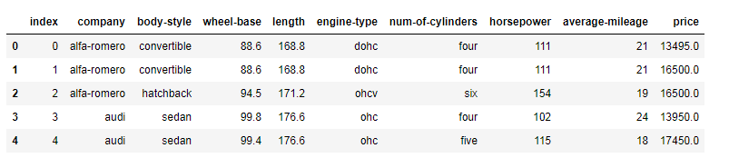
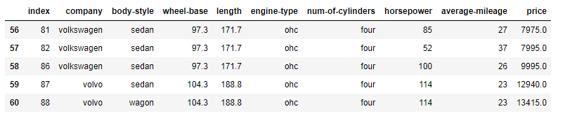

## **Exercise 1: From the given dataset print the first and last five rows**
**Expected Output:**


*Python Pandas printing first 5 rows*


*Python Pandas printing last 5 rows*


```python
import pandas as pd
df = pd.read_csv('Automobile_data.csv')
df.head(5)
```


<div>
<style scoped>
    .dataframe tbody tr th:only-of-type {
        vertical-align: middle;
    }

    .dataframe tbody tr th {
        vertical-align: top;
    }

    .dataframe thead th {
        text-align: right;
    }
</style>
<table border="1" class="dataframe">
  <thead>
    <tr style="text-align: right;">
      <th></th>
      <th>index</th>
      <th>company</th>
      <th>body-style</th>
      <th>wheel-base</th>
      <th>length</th>
      <th>engine-type</th>
      <th>num-of-cylinders</th>
      <th>horsepower</th>
      <th>average-mileage</th>
      <th>price</th>
    </tr>
  </thead>
  <tbody>
    <tr>
      <th>0</th>
      <td>0</td>
      <td>alfa-romero</td>
      <td>convertible</td>
      <td>88.6</td>
      <td>168.8</td>
      <td>dohc</td>
      <td>four</td>
      <td>111</td>
      <td>21</td>
      <td>13495.0</td>
    </tr>
    <tr>
      <th>1</th>
      <td>1</td>
      <td>alfa-romero</td>
      <td>convertible</td>
      <td>88.6</td>
      <td>168.8</td>
      <td>dohc</td>
      <td>four</td>
      <td>111</td>
      <td>21</td>
      <td>16500.0</td>
    </tr>
    <tr>
      <th>2</th>
      <td>2</td>
      <td>alfa-romero</td>
      <td>hatchback</td>
      <td>94.5</td>
      <td>171.2</td>
      <td>ohcv</td>
      <td>six</td>
      <td>154</td>
      <td>19</td>
      <td>16500.0</td>
    </tr>
    <tr>
      <th>3</th>
      <td>3</td>
      <td>audi</td>
      <td>sedan</td>
      <td>99.8</td>
      <td>176.6</td>
      <td>ohc</td>
      <td>four</td>
      <td>102</td>
      <td>24</td>
      <td>13950.0</td>
    </tr>
    <tr>
      <th>4</th>
      <td>4</td>
      <td>audi</td>
      <td>sedan</td>
      <td>99.4</td>
      <td>176.6</td>
      <td>ohc</td>
      <td>five</td>
      <td>115</td>
      <td>18</td>
      <td>17450.0</td>
    </tr>
  </tbody>
</table>
</div>


```python
import pandas as pd
df = pd.read_csv('Automobile_data.csv')
df.tail(5)
```


<div>
<style scoped>
    .dataframe tbody tr th:only-of-type {
        vertical-align: middle;
    }

    .dataframe tbody tr th {
        vertical-align: top;
    }

    .dataframe thead th {
        text-align: right;
    }
</style>
<table border="1" class="dataframe">
  <thead>
    <tr style="text-align: right;">
      <th></th>
      <th>index</th>
      <th>company</th>
      <th>body-style</th>
      <th>wheel-base</th>
      <th>length</th>
      <th>engine-type</th>
      <th>num-of-cylinders</th>
      <th>horsepower</th>
      <th>average-mileage</th>
      <th>price</th>
    </tr>
  </thead>
  <tbody>
    <tr>
      <th>56</th>
      <td>81</td>
      <td>volkswagen</td>
      <td>sedan</td>
      <td>97.3</td>
      <td>171.7</td>
      <td>ohc</td>
      <td>four</td>
      <td>85</td>
      <td>27</td>
      <td>7975.0</td>
    </tr>
    <tr>
      <th>57</th>
      <td>82</td>
      <td>volkswagen</td>
      <td>sedan</td>
      <td>97.3</td>
      <td>171.7</td>
      <td>ohc</td>
      <td>four</td>
      <td>52</td>
      <td>37</td>
      <td>7995.0</td>
    </tr>
    <tr>
      <th>58</th>
      <td>86</td>
      <td>volkswagen</td>
      <td>sedan</td>
      <td>97.3</td>
      <td>171.7</td>
      <td>ohc</td>
      <td>four</td>
      <td>100</td>
      <td>26</td>
      <td>9995.0</td>
    </tr>
    <tr>
      <th>59</th>
      <td>87</td>
      <td>volvo</td>
      <td>sedan</td>
      <td>104.3</td>
      <td>188.8</td>
      <td>ohc</td>
      <td>four</td>
      <td>114</td>
      <td>23</td>
      <td>12940.0</td>
    </tr>
    <tr>
      <th>60</th>
      <td>88</td>
      <td>volvo</td>
      <td>wagon</td>
      <td>104.3</td>
      <td>188.8</td>
      <td>ohc</td>
      <td>four</td>
      <td>114</td>
      <td>23</td>
      <td>13415.0</td>
    </tr>
  </tbody>
</table>
</div>


---
## **Exercise 2: Clean the dataset and update the CSV file**
**Replace all column values which contain ?, n.a, or NaN.**


```python
df = pd.read_csv("Automobile_data.csv", na_values={
'price':["?","n.a"],
'stroke':["?","n.a"],
'horsepower':["?","n.a"],
'peak-rpm':["?","n.a"],
'average-mileage':["?","n.a"]})
print (df)

df.to_csv("Automobile_data.csv")
```

        Unnamed: 0.2  Unnamed: 0.1  Unnamed: 0  index      company   body-style  \
    0              0             0           0      0  alfa-romero  convertible   
    1              1             1           1      1  alfa-romero  convertible   
    2              2             2           2      2  alfa-romero    hatchback   
    3              3             3           3      3         audi        sedan   
    4              4             4           4      4         audi        sedan   
    ..           ...           ...         ...    ...          ...          ...   
    56            56            56          56     81   volkswagen        sedan   
    57            57            57          57     82   volkswagen        sedan   
    58            58            58          58     86   volkswagen        sedan   
    59            59            59          59     87        volvo        sedan   
    60            60            60          60     88        volvo        wagon   
    
        wheel-base  length engine-type num-of-cylinders  horsepower  \
    0         88.6   168.8        dohc             four         111   
    1         88.6   168.8        dohc             four         111   
    2         94.5   171.2        ohcv              six         154   
    3         99.8   176.6         ohc             four         102   
    4         99.4   176.6         ohc             five         115   
    ..         ...     ...         ...              ...         ...   
    56        97.3   171.7         ohc             four          85   
    57        97.3   171.7         ohc             four          52   
    58        97.3   171.7         ohc             four         100   
    59       104.3   188.8         ohc             four         114   
    60       104.3   188.8         ohc             four         114   
    
        average-mileage    price  
    0                21  13495.0  
    1                21  16500.0  
    2                19  16500.0  
    3                24  13950.0  
    4                18  17450.0  
    ..              ...      ...  
    56               27   7975.0  
    57               37   7995.0  
    58               26   9995.0  
    59               23  12940.0  
    60               23  13415.0  
    
    [61 rows x 13 columns]
    
