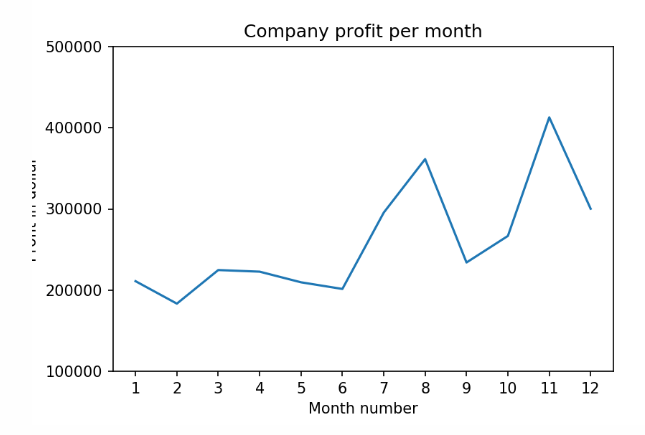
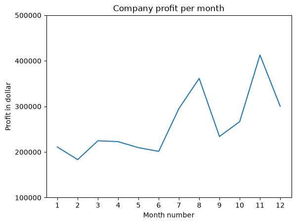
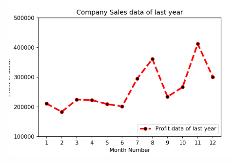
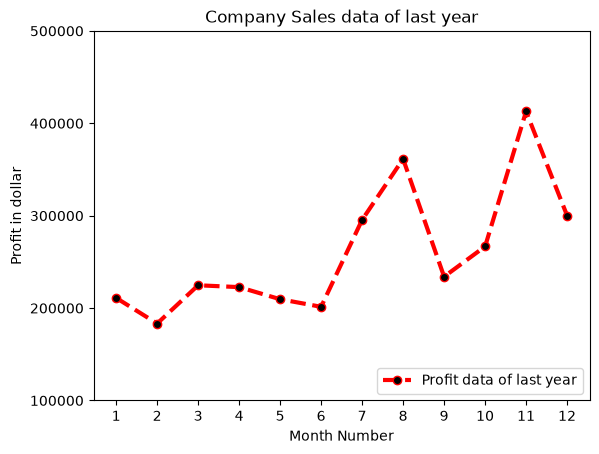

## **Exercise 1: Read Total profit of all months and show it using a line plot**

Total profit data provided for each month. Generated line plot must include the following properties: –

X label name = Month Number
Y label name = Total profit
The line plot graph should look like this.




```python
import pandas as pd
import matplotlib.pyplot as plt  

df = pd.read_csv("company_sales_data.csv")
profitList = df ['total_profit'].tolist()
monthList  = df ['month_number'].tolist()
plt.plot(monthList, profitList, label = 'Month-wise Profit data of last year')
plt.xlabel('Month number')
plt.ylabel('Profit in dollar')
plt.xticks(monthList)
plt.title('Company profit per month')
plt.yticks([100000, 200000, 300000, 400000, 500000])
plt.show()
```


    

    


---
## **Exercise 2: Get total profit of all months and show line plot with the following Style properties**

Generated line plot must include following Style properties: –

Line Style dotted and Line-color should be red
Show legend at the lower right location.
X label name = Month Number
Y label name = Sold units number
Add a circle marker.
Line marker color as read
Line width should be 3
The line plot graph should look like this.




```python
import pandas as pd
import matplotlib.pyplot as plt  

df = pd.read_csv("company_sales_data.csv")
profitList = df ['total_profit'].tolist()
monthList  = df ['month_number'].tolist()

plt.plot(monthList, profitList, label = 'Profit data of last year', 
      color='r', marker='o', markerfacecolor='k', 
      linestyle='--', linewidth=3)
      
plt.xlabel('Month Number')
plt.ylabel('Profit in dollar')
plt.legend(loc='lower right')
plt.title('Company Sales data of last year')
plt.xticks(monthList)
plt.yticks([100000, 200000, 300000, 400000, 500000])
plt.show()
```


    

    

